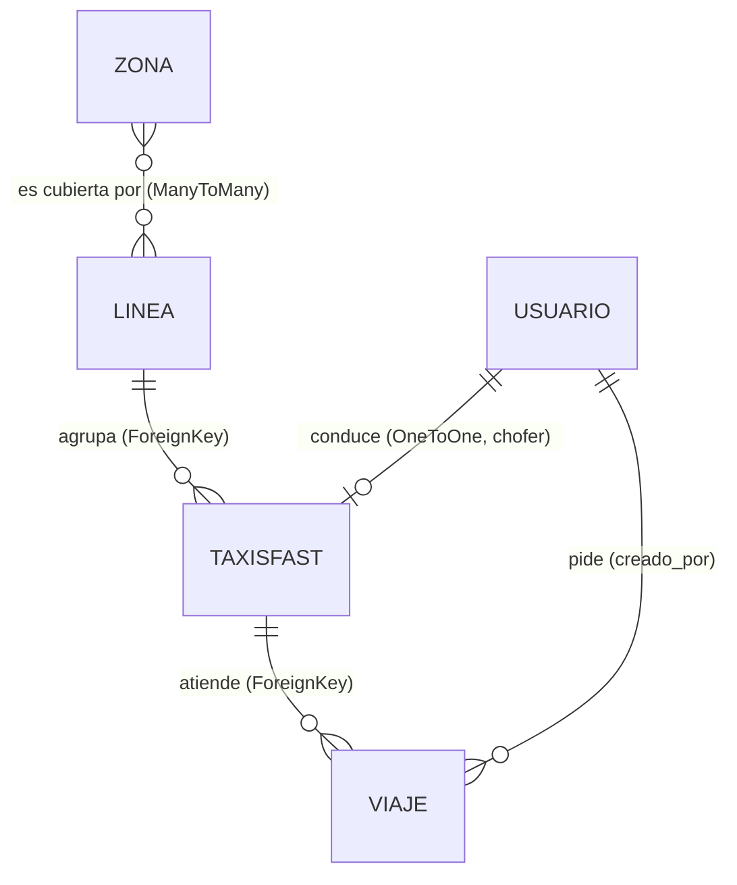

# TaxisFast

Aplicación web en **Django** para pedir y gestionar carreras de taxi.
Proyecto Django Individual de Programación II.

**Tema asignado:** Taxis (flota, líneas, zonas y carreras).

Hay tres tipos de usuario:

| Usuario | Qué hace |
|---|---|
| **Pasajero** | Se registra, pide carreras y ve, edita o cancela las suyas (mientras estén pendientes). |
| **Chofer** | Se registra con su taxi, ve las carreras pendientes y **acepta la que quiera**. Cambia su línea y su disponibilidad. |
| **Administrador** | Es uno solo. Ve choferes, pasajeros y viajes, y gestiona líneas y zonas. |

## Modelo de datos (4 tablas del tema + el usuario)



| Tabla (modelo) | Campos principales | Relaciones |
|---|---|---|
| `Zona` | nombre (único), descripcion | **ManyToMany** con `Linea` (`zona.lineas` / `linea.zonas`) |
| `Linea` | nombre, zona (texto), descripcion | M2M con `Zona`; `Linea.taxis` (un taxi pertenece a una línea) |
| `TaxisFast` | taxi, taxi_placa, **taxi_tarifa (Decimal)**, estado (`TextChoices`), taxi_fecha | **FK** a `Linea` (`SET_NULL`); **OneToOne** con el chofer (`CASCADE`) |
| `Viaje` | origen, destino, estado (`TextChoices`), created_at | **FK** `creado_por` → Usuario (`PROTECT`, `related_name="viajes_pedidos"`); **FK** `taxi` → TaxisFast (`PROTECT`, `related_name="viajes"`) |
| `Usuario` | usuario, contraseña (encriptada), correo, **rol**, teléfono | extiende `AbstractUser`; pertenece a un grupo según su rol |

Todos los modelos tienen `__str__`, `Meta` con `ordering` y `verbose_name`, y `get_absolute_url()`.
`creado_por` es el campo de propiedad: quien creó la carrera es su dueño.

## Estructura del proyecto

```
taxis_app/
├── config/                 settings.py, urls.py, wsgi.py
├── taxis/
│   ├── models/             usuario.py  zona.py  linea.py  taxi.py  viaje.py
│   ├── forms/              registro_form.py  zona_form.py  linea_form.py  taxi_form.py  viaje_form.py
│   ├── views/              auth_views  zona_views  linea_views  taxi_views  viaje_views  chofer_views  panel_views  general_views
│   ├── urls/               un archivo por entidad; __init__.py las reúne
│   ├── templates/taxis/    una carpeta por entidad (zonas/, lineas/, flota/, viajes/, ...)
│   ├── static/taxis/css/   estilos.css (hoja propia)
│   ├── management/commands/  crear_grupos.py  cargar_datos.py
│   ├── grupos.py           grupos y permisos
│   ├── migrations/  admin.py  apps.py  tests.py
├── manage.py
└── requirements.txt
```

## Cómo levantar el proyecto desde cero

```bash
git clone https://github.com/MayteRochina11/programacion-ii-mayte-rochina.git
cd programacion-ii-mayte-rochina/taxis_app

python3 -m venv env
source env/bin/activate
pip install -r requirements.txt

python manage.py migrate          # crea las tablas Y los grupos con sus permisos
python manage.py cargar_datos     # datos de prueba (ver abajo)
python manage.py runserver
```

Abre <http://127.0.0.1:8000/>.


## Datos de prueba

`python manage.py cargar_datos` carga, sin duplicar si se repite: 6 zonas, 5 líneas, 5 taxis,
5 choferes, 5 pasajeros y 7 viajes en distintos estados. También crea los grupos.

| Usuario | Contraseña | Rol | Grupo |
|---|---|---|---|
| `admin` | `Admin2026*` | Administrador (superusuario) | `administradores` |
| `chofer1` … `chofer5` | `Taxis2026*` | Chofer | `choferes` |
| `pasajero1` … `pasajero5` | `Taxis2026*` | Pasajero | `pasajeros` |

## Grupos y permisos

Los grupos se crean **por código** (`taxis/grupos.py`): solos al correr `migrate`, y también con
`python manage.py crear_grupos`. Cada usuario queda en el grupo de su rol automáticamente.

| Permiso | `pasajeros` | `choferes` | `administradores` |
|---|:-:|:-:|:-:|
| Ver zonas, líneas y flota | sí | sí | sí |
| Crear / editar / eliminar zonas y líneas | — | — | sí |
| Pedir carrera (`add_viaje`) | sí | — | sí |
| Editar / eliminar carrera (`change_`/`delete_viaje`) | solo la suya | — | cualquiera |
| Aceptar y completar carreras (`aceptar_viaje`, `completar_viaje`) | — | sí | sí* |
| Editar su taxi y su línea (`change_taxisfast`) | — | solo el suyo | sí* |
| Paneles de administración (`view_usuario`) | — | — | sí |

\* El grupo `administradores` recibe **todos** los permisos de la app, pero el administrador no tiene taxi, así que en la práctica no conduce ni acepta carreras.

- Las vistas se protegen con `@login_required` + `@permission_required`. Sin sesión → login; sin permiso → página **403**.
- Los botones se ocultan en las plantillas con ``, pero además la vista valida el permiso.
- **Regla de propiedad:** un pasajero edita o elimina una carrera solo si la creó (`creado_por`) y sigue pendiente. Otro pasajero del mismo grupo recibe 403.

## Estilos

La hoja `taxis/static/taxis/css/estilos.css` se carga con ``; no se usa ningún framework externo.
